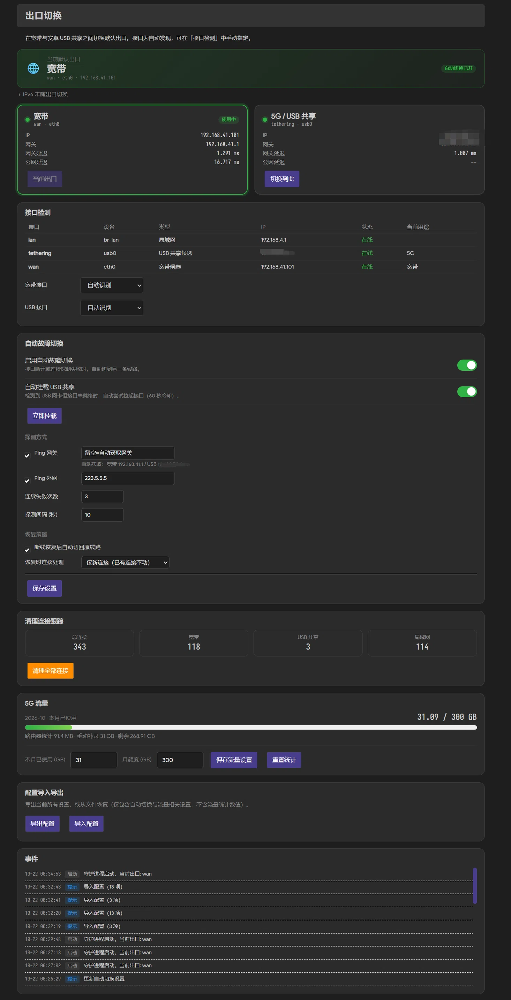

# luci-app-wans-switch

在 OpenWrt 上快速切换默认出口：**宽带（WAN）** ↔ **安卓 USB 共享（RNDIS）**。

一键切换路由器出口：宽带 ↔ 手机 / CPE 流量随需切换。

> A LuCI app for OpenWrt that switches the default route between WAN and Android USB tethering, with configurable failover, latency probing, traffic accounting and conntrack management.

> 由 **DeepSeek-Flash** 辅助开发。
---

## 功能

- **一键切换**：两张出口卡片，点一下就切，瞬时生效，不断开物理接口
- **接口自动发现**：通过 `ubus` 列出所有 netifd 接口并按特征分类（LAN / WAN / USB），页面上显示检测结果，可手动指定
- **自动故障切换**
  - 探测方式可勾选：Ping 网关（自动获取或手动指定）/ Ping 外网（默认 `223.5.5.5`，可改）
  - 连续失败次数可设置（默认 3）
  - 探测间隔可设置（默认 10 秒）
  - 恢复后可设置是否自动切回原线路
  - 恢复时连接如何处理：全部断开 / 仅新连接 / 不断线恢复
- **USB 共享自动挂载**：检测到 USB 网卡但接口未就绪时自动拉起；可手动「立即挂载」
- **连接跟踪统计**：显示总连接 / 宽带 / USB / 局域网 各自当前连接数
- **5G 流量统计**：累计经路由器转发的流量，支持手动补录「本月已使用」、设置月额度、进度条变色、重置流量统计等
- **配置导入导出**：导出为文本，导入时逐项校验
- **深色主题适配**：已适配 LuCI 暗色主题

## 界面



> 截图环境：OpenWrt 23.05 + LuCI 暗色主题，宽带与 USB 共享双出口。
## 工作原理

### 为什么不直接 ifdown/ifup

断开接口会触发 DHCP 重新协商、PPPoE 重拨、手机端 USB 共享重新握手，耗时几秒到几十秒，失败时还会彻底断网。而切换出口**只需要改一条默认路由**，毫秒级完成。

### 具体做法

不修改 netifd 的 metric 配置（不改 uci），而是往 `main` 路由表加一条**更高优先级（metric 0）的默认路由**：

```sh
# 切到 USB
ip route add default via <usb_gw> dev <usb_dev> src <usb_ip> metric 0

# 切回宽带
ip route del default dev <usb_dev> metric 0
```

netifd 原有的两条默认路由（例如Wan宽带 metric 1、USB共享 metric 3）保持不动作为兜底。

由于不写入 uci，**重启后自动回到默认出口（一般情况为wan出口）**。

守护进程每 10 秒做一次路由守卫，防止 DHCP 续租时 netifd 覆盖。

### 与 OpenClash 的关系

实测 OpenClash 在 redir-host 兼容模式下：

- TCP 通过 `nat PREROUTING REDIRECT` 劫持到代理端口
- UDP 通过 `mangle TPROXY` + `mark 0x162` 接管
- **代理软件自身连节点走 main 表默认路由**

所以改 main 表默认路由只改变 clash 出站和未代理流量的出口，代理链路（表 354 + mark）完全不受影响。

### 清理连接跟踪

切换后已有连接可能还绑在旧出口的 NAT 记录上。清理范围：

| 清理 | 说明 |
|---|---|
| `conntrack -D -s <LAN网段>` | 局域网设备上网连接 |
| `conntrack -D -d <LAN网段>` | 端口映射入站连接 |
| `conntrack -D -s <出口IP>` | 路由器自身出站：**openclash 连节点、DNS 上游、NTP、opkg** |

不清理回环（127.0.0.1）和 IPv6 出站（v6 路由未接管）。

## 配置项

全部保存在 `/etc/wansel/settings`，也可在页面修改。

| 键 | 默认 | 说明 |
|---|---|---|
| `auto` | 1 | 自动故障切换总开关 |
| `probe_gw` | 1 | 是否 Ping 网关 |
| `probe_gw_target` | 空 | 网关目标，留空自动获取；填写后仅对当前出口生效 |
| `probe_net` | 1 | 是否 Ping 外网 |
| `probe_net_target` | 223.5.5.5 | 外网探测目标 |
| `fail_threshold` | 3 | 连续失败次数 |
| `probe_interval` | 10 | 探测间隔（3-120 秒） |
| `auto_recover` | 0 | 恢复后是否自动切回原线路 |
| `recover_conn` | flush | 恢复时连接处理：`flush` / `new` / `keep` |
| `usb_autoup` | 1 | USB 共享自动挂载 |
| `flush_on_switch` | 1 | 手动切换时是否清连接 |
| `quota_gb` | 200 | 5G 月额度（GB） |
| `traffic_base_gb` | 0 | 本月已使用的手动补录值（GB） |
| `wan_if` | 空 | 手动指定宽带接口，空=自动识别 |
| `usb_if` | 空 | 手动指定 USB 接口，空=自动识别 |

## 命令行

```sh
wansel status                  # JSON 状态
wansel interfaces              # 接口发现结果
wansel switch usb              # 切到 5G
wansel switch wan              # 切回宽带
wansel flush                   # 立即清理连接跟踪
wansel usbmount                # 立即尝试挂载 USB 共享
wansel auto on|off             # 自动故障切换开关
wansel flushcfg on|off         # 切换时清理连接开关
wansel quota 200               # 设置月额度（GB）
wansel config k=v ...          # 批量更新配置
wansel export                  # 导出配置
wansel import <文件>           # 导入配置
wansel reset-traffic           # 重置本月流量统计
wansel set wan|usb <接口名>    # 手动指定接口（空=自动）
```

## 目录结构

```
root/
├── etc/init.d/wansel                          # procd 服务
├── usr/lib/wansel/common.sh                   # 公共库：接口发现、路由、探测、统计
├── usr/sbin/wansel                            # CLI
├── usr/sbin/wansel-daemon                     # 守护进程
├── usr/share/luci/menu.d/luci-app-wans-switch.json
├── usr/share/rpcd/acl.d/luci-app-wans-switch.json
└── www/luci-static/resources/view/wan_switch/overview.js
```

运行时文件：

- `/tmp/wansel/`：状态缓存、事件、探测结果（重启清空）
- `/etc/wansel/settings`：持久设置
- `/etc/wansel/traffic`：流量累计（重启保留）

## 接口识别规则

动态发现，不写死设备名：

| 类型 | 判定 |
|---|---|
| LAN | 接口名 `lan`，或设备 `br-*` |
| USB | 设备名 `usb*` / `rndis*` / `cdc*` / `enx*`，或接口名含 `tether` / `usb`；内核层按驱动 `rndis` / `cdc` / `usbnet` 识别 |
| WAN | 其余有 IPv4 的接口 |
| WAN 优先级 | 名字 `wan` > pppoe > `eth*` > 其他 > `wwan` |

识别不准时可在页面「接口检测」里手动指定。

## 兼容性

- OpenWrt 23.05 及以上（JS 版 LuCI）
- 已在 GL.iNet（gl-sdk4）固件上实测
- 需要 `jsonfilter`、`ip`；`conntrack` 可选
- OpenClash redir-host 模式已验证；TUN 模式不保证

## 卸载

```sh
/etc/init.d/wansel stop
/etc/init.d/wansel disable
rm -f /usr/sbin/wansel /usr/sbin/wansel-daemon /etc/init.d/wansel
rm -rf /usr/lib/wansel
rm -f /usr/share/luci/menu.d/luci-app-wans-switch.json
rm -f /usr/share/rpcd/acl.d/luci-app-wans-switch.json
rm -f /www/luci-static/resources/view/wan_switch/overview.js
rm -rf /etc/wansel
rm -f /tmp/luci-indexcache*
/etc/init.d/rpcd reload
```

## 常见问题

**菜单不显示 / 点开 403**
ACL 未生效。执行 `/etc/init.d/rpcd reload` 并**重新登录** LuCI。

**切换没反应**
先看 `wansel status`，确认 `wan.up` / `usb.up` 都是 1；再看 `logread | grep wansel`。

**导入配置报权限错误**
ACL 里 `/tmp/wansel/import.txt` 需要写权限，重载 rpcd 后重新登录。

**USB 共享设备未连接**
`usb0` 网卡不存在，说明手机端没开启 USB 网络共享。插件只能处理“接口存在但没起来”，无法从远端开启手机的共享开关。

**IPv6**
不接管。页面会提示「IPv6 未随出口切换」。

**LuCI 接口页提示「ifname 选项将被重命名」**
gl-tethering 写了旧格式配置。不要点「继续」（会重启网络），本插件不依赖该配置。

## License

MIT
