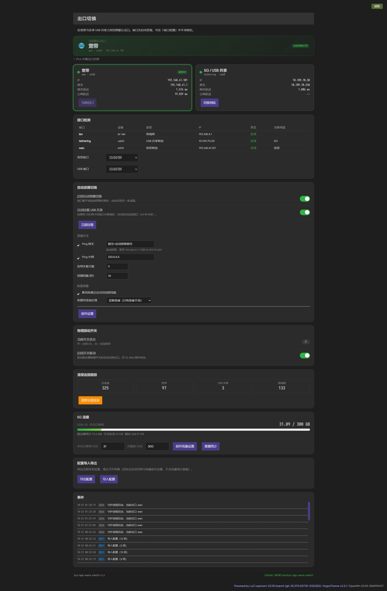

# luci-app-wans-switch

在 OpenWrt 上快速切换默认出口：**宽带（WAN）** ↔ **安卓 USB 共享（RNDIS）**。

一键切换路由器出口：宽带 ↔ 手机 / CPE 流量随需切换。

> A LuCI app for OpenWrt that switches the default route between WAN and Android USB tethering, with configurable failover, latency probing, traffic accounting and conntrack management.

> 由 **DeepSeek-Flash** 辅助开发。
---

## 功能

### 第一页：出口切换

- **一键切换**：两张出口卡片，点一下就切，瞬时生效，不断开物理接口
- **接口自动发现**：通过 `ubus` 列出所有 netifd 接口并按特征分类（LAN / WAN / USB），页面上显示检测结果，可手动指定
- **自动故障切换**
  - 探测方式可勾选：Ping 网关（自动获取或手动指定）/ Ping 外网（默认 `223.5.5.5`，可改）
  - 连续失败次数可设置（默认 3）
  - 探测间隔可设置（默认 10 秒）
  - 恢复后可设置是否自动切回原线路
  - 恢复时连接如何处理：全部断开 / 仅新连接 / 不断线恢复
- **USB 共享自动挂载**：检测到 USB 网卡但接口未就绪时自动拉起；可手动「立即挂载」
- **连接跟踪统计**：显示总连接 / 宽带 / USB / 局域网 各自当前连接数
- **5G 流量统计**：累计经路由器转发的流量，支持手动补录「本月已使用」、设置月额度、进度条变色、重置流量统计等
- **配置导入导出**：导出为文本，导入时逐项校验
- **物理拨动开关**（GL.iNet 固件）：开关拨到开 = 切到 5G，关 = 切回宽带；其他固件自动忽略

### 第二页：策略出口

- **按域名/IP 指定出口**：某些流量固定走宽带或 5G，不受第一页切换影响
- **IPv4 + IPv6 双栈**：`ip rule` 与 `ip -6 rule` 各一套，路由表 100/101 同时承载两代协议
- **规则组**：规则可归组，组行一键切换整组的出口和协议；支持折叠展开
- **单条规则编辑**：类型 / 值 / 出口 / 协议 / 组都可以改
- **内置预设**：一键填充网易云音乐的 7 条域名规则
- **从 URL 拉取规则**：支持远程规则文件，带预览再导入；兼容 Clash 格式
- **流量列表**：每条连接显示协议、源、目的、端口、流量、实际出口；支持按出口过滤、排除 DNS/内网噪音、手动刷新、清理旧连接
- **三层自愈**：开机服务 + OpenClash hook + watchdog，规则被清掉会自动重建

### 通用

- **深色主题适配**：两个页面都适配了 LuCI 暗色主题

## 界面



> 截图环境：OpenWrt 23.05 + LuCI 暗色主题，宽带与 USB 共享双出口。
## 工作原理

### 为什么不直接 ifdown/ifup

断开接口会触发 DHCP 重新协商、PPPoE 重拨、手机端 USB 共享重新握手，耗时几秒到几十秒，失败时还会彻底断网。而切换出口**只需要改一条默认路由**，毫秒级完成。

### 具体做法

不修改 netifd 的 metric 配置（不改 uci），而是往 `main` 路由表加一条**更高优先级（metric 0）的默认路由**：

```sh
# 切到 USB
ip route add default via <usb_gw> dev <usb_dev> src <usb_ip> metric 0

# 切回宽带
ip route del default dev <usb_dev> metric 0
```

netifd 原有的两条默认路由（例如Wan宽带 metric 1、USB共享 metric 3）保持不动作为兜底。

由于不写入 uci，**重启后自动回到默认出口（一般情况为wan出口）**。

守护进程每 10 秒做一次路由守卫，防止 DHCP 续租时 netifd 覆盖。

### 与 OpenClash 的关系

实测 OpenClash 在 redir-host 兼容模式下：

- TCP 通过 `nat PREROUTING REDIRECT` 劫持到代理端口
- UDP 通过 `mangle TPROXY` + `mark 0x162` 接管
- **代理软件自身连节点走 main 表默认路由**

所以改 main 表默认路由只改变 clash 出站和未代理流量的出口，代理链路（表 354 + mark）完全不受影响。

### 清理连接跟踪

切换后已有连接可能还绑在旧出口的 NAT 记录上。清理范围：

| 清理 | 说明 |
|---|---|
| `conntrack -D -s <LAN网段>` | 局域网设备上网连接 |
| `conntrack -D -d <LAN网段>` | 端口映射入站连接 |
| `conntrack -D -s <出口IP>` | 路由器自身出站：**openclash 连节点、DNS 上游、NTP、opkg** |

不清理回环（127.0.0.1）和 IPv6 出站（v6 路由未接管）。

## 策略出口（按域名/IP 指定出口）

第一页是「整个路由器切哪条线」，第二页是「某些流量单独走哪条线」，两者互不影响。

### 原理

```
域名规则 → dnsmasq --nftset 收集解析出的真实 IP → nft set
IP 规则  → 直接写入 nft set
        ↓
nft mangle PREROUTING 命中 set → 打标记（meta mark + ct mark）
        ↓
ip rule 按标记选独立路由表 → 固定从 eth0 或 usb0 出去
```

因为用的是**独立路由表**，所以第一页怎么切默认出口都不影响这里指定的流量。

### 三个出口选项

| 选项 | 行为 |
|---|---|
| 跟随默认 | 不处理，走 main 表（即第一页当前选的出口） |
| 宽带 | 打 mark `0x100` → table 100 → `eth0` |
| 5G | 打 mark `0x101` → table 101 → `usb0` |

### 为什么域名规则需要重启 DNS

dnsmasq 只在**处理 DNS 查询时**把解析结果写进 nft set。新增或修改域名规则后，必须让 dnsmasq 重新加载配置（`nftset=` 行写在 `/etc/dnsmasq.conf` 的标记块里），所以页面上有两个按钮：

- **应用规则**：只更新 nft 集合和路由，不重启 DNS
- **应用并重启 DNS**：新增/修改域名后必须点这个

### CDN 换 IP 的应对

域名解析出的 IP 会随 CDN 调度变化，而客户端又有 DNS 缓存，可能出现「规则里的 IP 不是客户端正在用的 IP」。为此 watchdog 每 10 分钟会对规则里的域名主动 `nslookup` 一次，强制刷新集合。

如果某些服务换 IP 特别频繁，最稳的办法是直接加 **IP / CIDR 规则**（页面上选「IP / CIDR」类型）。

### 规则何时会被清掉，以及怎么恢复

OpenClash 每次重载防火墙都会重建 `inet fw4` 表，`nft set` 和 mark 规则会丢失。三层恢复机制：

| 机制 | 触发时机 |
|---|---|
| 开机服务 `wansel-egress` | 开机时重建 ip rule / 路由表 / nft 规则 |
| OpenClash hook（页面开关，默认开） | 防火墙重载后延迟 8 秒执行 `wansel-egress apply` |
| watchdog（30 秒轮询） | 发现 set 或规则缺失就重建 |

### IPv4 / IPv6

策略出口同时支持两代协议，规则里的「协议」字段控制该域名收集哪一类地址：

| 协议 | 行为 |
|---|---|
| IPv4+IPv6 | A 和 AAAA 都收集，两个集合各自打标记 |
| 仅 IPv4 | 只把 A 记录写进 v4 集合，AAAA 不参与策略 |
| 仅 IPv6 | 只把 AAAA 记录写进 v6 集合，A 不参与策略 |

路由层是双份的：`ip rule` 和 `ip -6 rule` 各一套，路由表 100/101 同时放 IPv4 和 IPv6 默认路由。

> **注意**：这里控制的是「哪些地址进入策略集合」，**不是**「让域名只解析某一代」。
> dnsmasq 的按域名 `filter-AAAA` 在部分固件构建里没有编译进去（会报 `extraneous parameter`，导致 dnsmasq 无法启动），所以插件不写入该选项。
> 如果需要让某个域名只解析 IPv4，建议在 LuCI 的「DHCP/DNS → 过滤 AAAA」里做全局设置，或者用 IP 规则直接锁定。

### 规则组

每条规则可以带一个「组」名。规则列表按组显示成树形结构：

```
▼ 📁 netease（7 条）        [宽带 ▾]  [IPv4+IPv6 ▾]  [应用到组]
   └ music.126.net (域名)    宽带      IPv4+IPv6      [编辑][删除]
   └ music.163.com (域名)    宽带      IPv4+IPv6      [编辑][删除]
   └ interface.music.163.com ...
（未分组）
   └ 某个单条规则            5G        仅 IPv4        [编辑][删除]
```

**组行**：

- 左边的 `▼` / `▶` 可以折叠展开
- 出口和协议下拉是「组级设置」，点「应用到组」会改整组
- 如果组内规则的出口不一致，下拉框会显示「混合」并提示先选具体值

**子行**：

- 缩进显示，带 `└` 前缀
- 点「编辑」可以改这条规则的类型 / 值 / 出口 / 协议 / 组
- 改了「值」会自动重建 uci section 名，不会留下旧名字

**组的创建与消失**：组不单独存储，只要有一条规则带了这个组名，组就存在。删光组内规则，组自动消失。在添加表单里输入一个新组名，也会自动建组。

### 从 URL 拉取规则

页面上的「从url拉取规则」支持两种来源：

**内置预设**：选「内置：网易云音乐」，一键填入 7 条域名（`music.126.net`、`music.163.com`、`interface.music.163.com`、`ipv4.music.163.com`、`163yun.com`、`api.iplay.163.com`、`music.163.com.163jiasu.com`）。

**远程规则文件**：填一个 http/https 地址，点「预览」先看解析结果，确认后点「导入」。

规则文件格式（每行一条，`#` 开头为注释）：

```
# 网易云音乐
domain music.126.net
domain music.163.com
ip 59.111.128.0/17
```

解析器兼容这些写法：

| 写法 | 识别 |
|---|---|
| `domain xxx` / `ip xxx` | 显式声明 |
| `DOMAIN-SUFFIX,xxx` / `DOMAIN,xxx` | Clash 格式 |
| `IP-CIDR,xxx` / `IP-CIDR6,xxx` | Clash 格式 |
| 纯域名 / 纯 IP | 自动判断 |

限制：单文件 256 KB、最多 200 条、仅支持 http/https。

### 流量列表

每条连接一行，显示：

| 列 | 说明 |
|---|---|
| 协议 | tcp / udp |
| 源 | 客户端地址 |
| 目的 | 对端 IP |
| 端口 | 对端端口 |
| 流量 | 该连接的累计字节数 |
| 出口 | 宽带 / 5G / 跟随默认 |

**过滤**：

- 顶部下拉可以按出口筛选：全部 / 只看宽带 / 只看 5G / 只看跟随默认 / 只看规则命中
- **排除 DNS**：勾选后不显示目的端口 53 的连接
- **排除内网**：勾选后不显示源和目的都是私有地址的连接（含 `fe80::` 链路本地）

**操作**：

- **刷新**：立即重新拉取（默认 20 秒自动刷新一次）
- **清理旧连接**：删除所有非 `ESTABLISHED` 状态的连接（`TIME_WAIT` / `CLOSE` / `CLOSE_WAIT` / `FIN_WAIT` / `LAST_ACK` / `SYN_SENT`），点之前会弹确认框

**出口判断逻辑**：

1. `ct mark = 0x100` → 宽带
2. `ct mark = 0x101` → 5G
3. 目的 IP 在当前 nft 集合里 → 对应出口（兜底，用于连接建立时还没打标记的情况）
4. 其余 → 跟随默认

> 这里只反映**策略出口**，不反映 OpenClash 的代理分流。走代理的连接目的地址是代理节点，会显示「跟随默认」。

### 出口状态卡

页面顶部两个卡片：

- 🌐 **宽带** / 📶 **5G**
- 左侧状态点：绿色在线，灰色离线
- 数值显示「在线 / 离线」
- 副标题显示「匹配 IP: v4 数量 / v6 数量」

### 性能说明

规则被拆成三层，平时几乎不占资源：

| 组件 | 频率 | 开销 |
|---|---|---|
| 开机服务 | 仅开机 | 一次 apply |
| OpenClash hook | 防火墙重载后 | 延迟 8 秒执行一次 apply |
| watchdog | 每 30 秒 | 只读检查（`nft list` / `ip rule`），不写文件 |
| watchdog DNS 刷新 | 每 10 分钟 | 每个域名 2 次 `nslookup` |
| 页面 poll | 10 秒 / 20 秒 | 仅页面打开时，约 1% 单核 |

实测在 GL-AXT1800 上：`0% io`，CPU 占用可忽略。离开页面后 poll 自动停止。


### 命令行

```sh
wansel-egress list                                            # 列出规则（JSON）
wansel-egress add domain music.126.net wan ipv4               # 加域名规则（仅 IPv4）
wansel-egress add domain example.com usb ipv6                 # 加域名规则（仅 IPv6）
wansel-egress add ip 36.150.226.0/24 usb                      # 加 IPv4 段规则
wansel-egress add ip 240e:979::/48 wan                        # 加 IPv6 段规则
wansel-egress del music.126.net                               # 删规则
wansel-egress apply                                           # 应用（不重启 DNS）
wansel-egress apply dns                                       # 应用并重启 DNS
wansel-egress status                                          # 状态（JSON，含 v4/v6 计数）
wansel-egress connections [all|wan|usb|default|matched] [nodns,nolan]  # 连接列表
wansel-egress flush [stale|all]                              # 清理旧连接
wansel-egress preset list                                     # 列出内置预设
wansel-egress preset apply netease wan both                   # 应用内置预设
wansel-egress edit <old> domain <new> wan both [group]        # 编辑单条规则
wansel-egress group list                                      # 列出规则组
wansel-egress group set <group> <via> [family]                # 按组批量改出口
wansel-egress group rename <old> <new>                        # 重命名组
wansel-egress fetch <url>                                     # 下载并预览规则（JSON）
wansel-egress import <url> wan both                           # 下载并导入规则
wansel-egress hook on|off                                     # OpenClash hook 开关
wansel-egress cleanup                                         # 清理所有策略出口规则
```

### 规则文件格式

```
# 注释行
domain music.126.net
domain music.163.com
ip 59.111.128.0/17
```

也兼容纯域名/纯 IP 和 Clash 写法（`DOMAIN-SUFFIX,`、`IP-CIDR,`）。


## 配置项

全部保存在 `/etc/wansel/settings`，也可在页面修改。

| 键 | 默认 | 说明 |
|---|---|---|
| `auto` | 1 | 自动故障切换总开关 |
| `probe_gw` | 1 | 是否 Ping 网关 |
| `probe_gw_target` | 空 | 网关目标，留空自动获取；填写后仅对当前出口生效 |
| `probe_net` | 1 | 是否 Ping 外网 |
| `probe_net_target` | 223.5.5.5 | 外网探测目标 |
| `fail_threshold` | 3 | 连续失败次数 |
| `probe_interval` | 10 | 探测间隔（3-120 秒） |
| `auto_recover` | 0 | 恢复后是否自动切回原线路 |
| `recover_conn` | flush | 恢复时连接处理：`flush` / `new` / `keep` |
| `usb_autoup` | 1 | USB 共享自动挂载 |
| `flush_on_switch` | 1 | 手动切换时是否清连接 |
| `quota_gb` | 200 | 5G 月额度（GB） |
| `traffic_base_gb` | 0 | 本月已使用的手动补录值（GB） |
| `wan_if` | 空 | 手动指定宽带接口，空=自动识别 |
| `usb_if` | 空 | 手动指定 USB 接口，空=自动识别 |

## 命令行

```sh
wansel status                  # JSON 状态
wansel interfaces              # 接口发现结果
wansel switch usb              # 切到 5G
wansel switch wan              # 切回宽带
wansel flush                   # 立即清理连接跟踪
wansel usbmount                # 立即尝试挂载 USB 共享
wansel auto on|off             # 自动故障切换开关
wansel flushcfg on|off         # 切换时清理连接开关
wansel quota 200               # 设置月额度（GB）
wansel config k=v ...          # 批量更新配置
wansel export                  # 导出配置
wansel import <文件>           # 导入配置
wansel reset-traffic           # 重置本月流量统计
wansel set wan|usb <接口名>    # 手动指定接口（空=自动）
```

## 目录结构

```
root/
├── etc/init.d/wansel                          # procd 服务
├── etc/init.d/wansel-switchd                  # 物理拨动开关监听
├── etc/init.d/wansel-egress                   # 策略出口开机服务
├── etc/init.d/wansel-egress-watchdog          # 策略出口守护
├── usr/lib/wansel/common.sh                   # 公共库：接口发现、路由、探测、统计
├── usr/sbin/wansel                            # CLI
├── usr/sbin/wansel-daemon                     # 守护进程
├── usr/sbin/wansel-switchd                    # 物理开关监听
├── usr/sbin/wansel-egress                     # 策略出口 CLI
├── usr/sbin/wansel-egress-watchdog            # 策略出口守护脚本
├── usr/share/luci/menu.d/luci-app-wans-switch.json
├── usr/share/rpcd/acl.d/luci-app-wans-switch.json
└── www/luci-static/resources/view/wan_switch/
    ├── overview.js                            # 出口切换页
    └── egress.js                              # 策略出口页
```

运行时文件：

- `/tmp/wansel/`：状态缓存、事件、探测结果（重启清空）
- `/var/run/wansel-egress/`：策略出口应用时间戳
- `/etc/wansel/settings`：持久设置
- `/etc/wansel/traffic`：流量累计（重启保留）
- `/etc/config/wansel_egress`：策略出口规则（UCI）
- `/etc/dnsmasq.conf`：策略出口的 `nftset=` 行写在标记块内

## 接口识别规则

动态发现，不写死设备名：

| 类型 | 判定 |
|---|---|
| LAN | 接口名 `lan`，或设备 `br-*` |
| USB | 设备名 `usb*` / `rndis*` / `cdc*` / `enx*`，或接口名含 `tether` / `usb`；内核层按驱动 `rndis` / `cdc` / `usbnet` 识别 |
| WAN | 其余有 IPv4 的接口 |
| WAN 优先级 | 名字 `wan` > pppoe > `eth*` > 其他 > `wwan` |

识别不准时可在页面「接口检测」里手动指定。

## 兼容性

- OpenWrt 23.05 及以上（JS 版 LuCI）
- 已在 GL.iNet（gl-sdk4）固件上实测
- 需要 `jsonfilter`、`ip`；`conntrack` 可选
- OpenClash redir-host 模式已验证；TUN 模式不保证

## 内置预设

### 网易云音乐（`netease`）

一键填充 7 条域名规则：

| 域名 | 说明 |
|---|---|
| `music.126.net` | 音频与图片 CDN 总域，覆盖 `p1-p4` / `m10` 等子域 |
| `music.163.com` | 主站 |
| `interface.music.163.com` | 客户端 API 主入口 |
| `ipv4.music.163.com` | 强制 IPv4 的 API 入口 |
| `163yun.com` | 网易云对象存储（封面、歌词） |
| `api.iplay.163.com` | 播放相关接口 |
| `music.163.com.163jiasu.com` | 网易加速域名 |

**没有包含 IP 段**。网易云的 IP 段（`59.111.128.0/17`、`223.252.192.0/19`、`115.236.112.0/20`）会误伤同网段的其他网易服务，如果要兜底可以自己加 IP 规则。

其余服务请用「从 URL 拉取规则」导入，或在添加表单里逐条加。

## 已知限制

### 出口切换

- **IPv6 不随第一页切换**：第一页只改 IPv4 默认路由，IPv6 走自己的默认路由（可能是另一条线）。需要 IPv6 受控时用第二页的策略出口。
- **不重连接口**：切换只改路由，不 ifdown/ifup，所以手机端 USB 共享彻底断开时无法通过插件恢复。

### 策略出口

- **DoH/DoT 会绕过收集**：客户端用加密 DNS（如 `8.8.8.8:853`）时查询不经过 dnsmasq，对应 IP 不会被收集。
- **硬编码 IP 的应用收不到**：不查 DNS 直接连 IP 的客户端无法被域名规则覆盖。
- **CDN 换 IP 有延迟**：集合靠 DNS 解析累积，watchdog 每 10 分钟补一次，极端情况下新 IP 最多晚 10 分钟生效。
- **不支持按域名过滤 AAAA**：当前固件的 dnsmasq 2.89 没有编译 `filter-AAAA`，写入会导致 DNS 服务启动失败。协议族字段只控制「收集哪类地址」，不控制「解析返回哪类」。
- **走代理的连接看不到真实出口**：OpenClash 代理后的流量目的地址是节点 IP，会显示「跟随默认」。

### 连接列表

- **最多显示 100 条**：超出部分不渲染，避免页面卡顿。
- **出口判断只看策略出口**：不反映 OpenClash 的代理分流。

## 卸载

```sh
/etc/init.d/wansel stop
/etc/init.d/wansel disable
/etc/init.d/wansel-switchd stop 2>/dev/null
/etc/init.d/wansel-switchd disable 2>/dev/null
/etc/init.d/wansel-egress stop 2>/dev/null
/etc/init.d/wansel-egress disable 2>/dev/null
/etc/init.d/wansel-egress-watchdog stop 2>/dev/null
/etc/init.d/wansel-egress-watchdog disable 2>/dev/null
/usr/sbin/wansel-egress hook off 2>/dev/null
/usr/sbin/wansel-egress cleanup 2>/dev/null
rm -f /usr/sbin/wansel /usr/sbin/wansel-daemon /usr/sbin/wansel-switchd
rm -f /usr/sbin/wansel-egress /usr/sbin/wansel-egress-watchdog
rm -f /etc/init.d/wansel /etc/init.d/wansel-switchd
rm -f /etc/init.d/wansel-egress /etc/init.d/wansel-egress-watchdog
rm -rf /usr/lib/wansel
rm -f /usr/share/luci/menu.d/luci-app-wans-switch.json
rm -f /usr/share/rpcd/acl.d/luci-app-wans-switch.json
rm -f /www/luci-static/resources/view/wan_switch/overview.js
rm -f /www/luci-static/resources/view/wan_switch/egress.js
rm -rf /etc/wansel
rm -f /etc/config/wansel_egress
rm -f /tmp/luci-indexcache*
/etc/init.d/rpcd reload
```

> 卸载策略出口后，`/etc/dnsmasq.conf` 里可能残留标记块，可手动删除 `# >>> wansel-egress nftset >>>` 到 `# <<< wansel-egress nftset <<<` 之间的内容并重启 dnsmasq。

## 常见问题

**菜单不显示 / 点开 403**
ACL 未生效。执行 `/etc/init.d/rpcd reload` 并**重新登录** LuCI。

**切换没反应**
先看 `wansel status`，确认 `wan.up` / `usb.up` 都是 1；再看 `logread | grep wansel`。

**导入配置报权限错误**
ACL 里 `/tmp/wansel/import.txt` 需要写权限，重载 rpcd 后重新登录。

**USB 共享设备未连接**
`usb0` 网卡不存在，说明手机端没开启 USB 网络共享。插件只能处理“接口存在但没起来”，无法从远端开启手机的共享开关。

**IPv6**
不接管。页面会提示「IPv6 未随出口切换」。

**LuCI 接口页提示「ifname 选项将被重命名」**
gl-tethering 写了旧格式配置。不要点「继续」（会重启网络），本插件不依赖该配置。

## License

MIT
